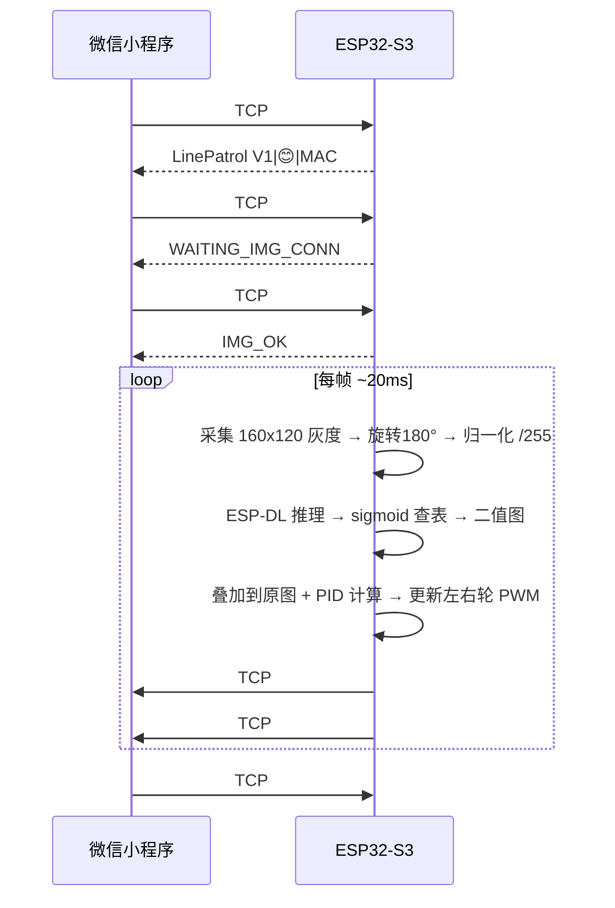
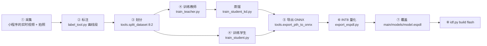

# AICleanBot

**[English](README_EN.md) | 简体中文**

**An Open-Source AI Robot on ESP32-S3** · 实时语义分割 · 自主循迹 · 边缘推理

[](LICENSE)
[](https://docs.espressif.com/projects/esp-idf/)
[](https://www.espressif.com/en/products/socs/esp32-s3)
[](https://aishuaiyao.github.io/AICleanBot/)

**[🌐 项目官网](https://aishuaiyao.github.io/AICleanBot/)** · **[🔧 硬件资料](hardware/)** · **[🗺 Roadmap](ROADMAP.md)** · **[🤝 贡献指南](CONTRIBUTING.md)**


基于 **ESP32-S3** 的实时语义分割机器人：在一块 40 元的 MCU 上跑 U-Net 分割模型，从摄像头画面里找出引导线，再用 PID 驱动电机循迹。

项目提供的是**完整闭环**——插上就能采集数据、点几下就能训练、改一行就能把新模型烧回板子：

```
摄像头采数据 → 小程序遥控采集 → PC 标注 → 训练/蒸馏 → INT8 量化 → 回到板端推理 → 驱动轮子
```

整个过程不需要任何云端 GPU，也不需要额外购买上位机。

> 仓库已经自带 **262 张标注好的数据**（train 209 / val 53）和 **训练好的 INT8 模型**，
> 所以上面这条链路上的任意一环都可以单独拆出来跑：没有硬件也能训练，没有数据也能烧固件。

| 项目 | 指标 |
|------|------|
| 主控 | ESP32-S3，240MHz，8MB Flash + 8MB PSRAM |
| 模型输入 | 160×120 单通道灰度（QQVGA） |
| 板端模型 | U-Net 轻量变体 `UNetMiniExp5`，INT8，约 148 KB |
| 任务 | 逐像素二分类（背景 / 引导线） |
| 控制 | 质心偏差 → PID → 双轮差速 |

### 实测指标

下面这组数字全部来自仓库 `logs/` 里保留的真实训练日志，同一份数据集（262 张、8:2 划分、`seed=42`）、同一套超参，用来判断你的复现是否到位：

| 模型 | Best val IoU | 权重体积 | 能否上板 |
|------|-------------|---------|---------|
| U-Net + ResNet18（教师） | **0.9100** | 大 | ❌ 只在 PC 上跑，作蒸馏教师 |
| `UNetMiniExp5`（直接训练） | 0.8169 → 0.8574 | ~334 KB | ✅ |
| `UNetMiniExp5` + 知识蒸馏 | **0.8791** | ~334 KB | ✅ ← 仓库里自带的部署模型就是它 |

对应日志：`logs/train/20260416_213640_UNet_ResNet18.txt`（教师）、`logs/train/20260416_225153_UNetMiniExp5_KD.txt`（蒸馏学生）。

蒸馏把同一个小模型的 IoU 从 0.857 拉到 0.879，代价只是多跑一次教师训练；而教师本身也只有 0.910 —— 在这个 160×120 的单通道任务上，小模型已经接近天花板，再堆容量收益很小。

**板端速度请自己实测**，这里不写死一个数字：不同摄像头模组、PSRAM 批次、WiFi 干扰下差异很大，写死反而会误导。进入实验模式后，串口**每 100 帧**会打印一次各阶段耗时：

```
[Exp] 帧0100 | 采<ms> 预<ms> 推<ms> 后<ms> 叠<ms> | 控<ms> 传<ms> | 总<ms> | G1=.. G2=.. | 线OK
                             ↑ 这一项就是模型推理耗时
```

`idf.py -p COM3 monitor` 就能看到。

---

## 目录

- [效果展示](#效果展示)
- [实测指标](#实测指标)
- [功能特性](#功能特性)
- [两条上手路线](#两条上手路线)
- [硬件准备](#硬件准备)
- [软件环境](#软件环境)
- [路线 A：用预训练模型跑通循迹](#路线-a用预训练模型跑通循迹)
- [路线 B：训练自己的模型](#路线-b训练自己的模型)
- [通信协议](#通信协议)
- [目录结构](#目录结构)
- [代码导览（固件）](#代码导览固件)
- [Python 工具速查](#python-工具速查)
- [排障 FAQ](#排障-faq)
- [Roadmap](#roadmap)
- [致谢](#致谢)
- [引用](#引用)
- [许可证](#许可证)

---

## 效果展示

| 自主循迹实跑 | 整机 |
|---|---|
|  |  |

更多实拍、三视图、3D 打印件与接线照片见 [hardware/photos](hardware/photos)，演示视频见[项目官网](https://aishuaiyao.github.io/AICleanBot/#demo)。

---

## 功能特性

**固件（`main/`）**

- ESP-DL 加载 INT8 模型，逐帧做 160×120 语义分割
- Sigmoid 查表加速后处理，不跑浮点一个像素也不放过
- 质心法求引导线位置，PID 差速控制双轮
- 3 号电机（清洁/吸尘）独立 PWM 调速
- 编码器滑动窗口做**碰撞检测**（掉速到均值 85% 触发），无需额外传感器
- 丢线保护：连续 5 帧找不到线自动停车
- 电池电压 ADC 采样 + 呼吸灯状态指示
- **双通道通信**：TCP 5000 发命令，UDP 5001 推视频流，实验模式再开一条 TCP 专门回传分割叠加图
- **OTA 空中升级**：双 app 分区，烧一次固件之后全部走网络更新

**上位机（`smartcat/` 子模块）**

微信小程序原生实现：设备发现、TCP 握手、实时视频、单帧拍照、遥控、数据集本地/云端管理、编码器数据记录与柱状图导出。

**训练工具（`py_scripts/`）**

教师模型（U-Net + ResNet18 编码器）→ 知识蒸馏 → 轻量学生模型 → ONNX → INT8 量化 → `.espdl`，一条脚本链走完。

---

## 两条上手路线

| | 路线 A | 路线 B |
|---|---|---|
| **做什么** | 直接用仓库里已经训练好的模型跑循迹 | 用自己采集的数据重新训练模型 |
| **需要** | 一块 ESP32-S3 + 硬件 | 路线 A 的全部 + 一台能跑 PyTorch 的电脑 |
| **耗时** | 约 30 分钟（含焊接） | 训练另计，CPU 数小时 / GPU 半小时 |
| **你会得到** | 一台能循迹、能 cleaning 的车 | 一个适配你自己地面场景的新模型 |

如果你是第一次接触，先走通路线 A，再回头做路线 B。

---

## 硬件准备

> 更完整的硬件资料在 **[`hardware/`](hardware/README.md)**：机读版 BOM、原理图 PDF、TB6612 驱动手册、嘉立创 EDA 工程、可直接切片的 STL 模型、装配顺序与接线照片。

### 物料清单

| 组件 | 型号 / 规格 | 数量 | 备注 |
|------|------------|------|------|
| 主控 | ESP32-S3-WROOM-1（N16R8，8MB PSRAM） | 1 | **必须带 PSRAM**，摄像头帧缓冲放 PSRAM |
| 摄像头 | OV2640 | 1 | 与 ESP32-S3 直连，无 FIFO |
| 电机驱动 | TB6612FNG | 1 | 比 L298N 省电、体积小 |
| 减速电机 | JGA25-370 带 AB 相编码器 | 2 | 编码器做里程与碰撞检测 |
| 清洁电机 | 小型直流电机 + 驱动 | 1 | 即 3 号电机，可选 |
| 电池 | 12V 锂电池组 | 1 | 经 DC-DC 降到 5V 给主控 |
| 降压模块 | 12V → 5V DC-DC | 1 | 输出电流 ≥ 2A |
| 分压电阻 | 100k + 10k（1:11） | 1 对 | 电池采样，见下 |
| 车体 / 轮子 / 万向轮 | — | 1 套 | — |

> **关于 PSRAM**：`sdkconfig.defaults.esp32s3` 里开启了 `CONFIG_SPIRAM=y` 且 `fb_location = CAMERA_FB_IN_PSRAM`。不焊接 PSRAM 的模组编译能过，运行必定在 `esp_camera_init` 处崩。

> **关于摄像头**：本项目**不使用**那种自带 FIFO、带排针的"ESP32-CAM"模块，而是 OV2640 裸摄像头直连 ESP32-S3 的 8 位数据总线。如果你手上只有 ESP32-CAM 模块，需要引脚全部重映射。

### 引脚接线

**摄像头（OV2640）**

| 功能 | GPIO | 功能 | GPIO |
|------|------|------|------|
| XCLK | 15 | D0 | 11 |
| SIOD (SDA) | 4 | D1 | 9 |
| SIOC (SCL) | 5 | D2 | 8 |
| VSYNC | 6 | D3 | 10 |
| HREF | 7 | D4 | 12 |
| PCLK | 13 | D5 | 18 |
| — | — | D6 | 17 |
| — | — | D7 | 16 |

XCLK 输出 20MHz。PWDN / RESET 未使用（均为 -1）。

**电机驱动（TB6612FNG）**

| 功能 | GPIO | 说明 |
|------|------|------|
| 左轮 PWM | 39 | PWMB，速度控制 |
| 左轮 IN1 | 2 | 与右轮 IN1 **共用** GPIO2 |
| 左轮 IN2 | 42 | 与右轮 IN2 **共用** GPIO42 |
| 右轮 PWM | 14 | PWMA，速度控制 |
| 3 号电机 PWM | 45 | LEDC 通道 4，初始占空比 20% |

> IN1/IN2 两轮共用意味着**只能差速不能差方向**，转向靠 PWM 差值实现。这是有意的设计让步：省下 4 个 GPIO 留给摄像头。如果你的板子 GPIO 富余，可以把左右的 IN1/IN2 拆开，然后修改 `main/app_main.cpp` 顶部的 `#define`。

**编码器（JGA25-370）**

| 功能 | GPIO |
|------|------|
| 左轮 A 相 | 47 |
| 左轮 B 相 | 21 |
| 右轮 A 相 | 41 |
| 右轮 B 相 | 40 |

固件使用 **PCNT 单通道一倍频**（A 相上升沿计数）。编码器每 32768 个脉冲清零，上位机侧会跳变滤除。

**其他**

| 功能 | GPIO | 说明 |
|------|------|------|
| 电池电压检测 | 1 | ADC1_CH0，分压比 1/11 |
| 呼吸灯 | 38 | LEDC 通道 3，10 位分辨率 |

LED PWM 参数：电机 1kHz / 8 位，呼吸灯 10 位。

### 接线检查清单

在上电之前请确认：

- [ ] 摄像头 **8 根数据线顺序**没错——这是最容易接错且唯一没有报错提示的地方
- [ ] TB6612 的 **PWMA/PWMB** 分别接到 14 / 39，接反表现为"左转让他往右"
- [ ] 电机驱动的 **STBY** 引脚拉高（很多同学忘了，表现为电机完全不动但日志正常）
- [ ] 编码器 **A/B 相都接了**，只接 A 相能转但速度环失效
- [ ] 电池分压用 **100k + 10k**，ADC 引脚承受不了 12V 直连

---

## 软件环境

### 1. 克隆仓库

`smartcat` 是 git submodule，**必须**用 `--recurse-submodules`，否则小程序目录是空的：

```bash
# Windows PowerShell / Linux / macOS
git clone --recurse-submodules https://github.com/AishuaiYao/AICleanBot.git
cd AICleanBot
```

已经克隆过的：

```bash
git submodule update --init --recursive
```

### 2. ESP-IDF（固件必装）

本项目基于 **ESP-IDF v5.4.x**，实测 v5.4.0。ESP-DL 要求 IDF ≥ 5.3。

按官方文档安装即可：

- Windows：<https://docs.espressif.com/projects/esp-idf/zh_CN/v5.4/esp32s3/get-started/windows-setup.html>
  推荐「离线安装包」，会自动配好 Python、CMake、Ninja、工具链
- Linux / macOS：<https://docs.espressif.com/projects/esp-idf/zh_CN/v5.4/esp32s3/get-started/linux-macos-setup.html>

装好后验证：

```bash
idf.py --version      # 期望 ESP-IDF v5.4.x
```

Windows 用户每次开新终端都要先激活环境：

```powershell
# ESP-IDF 5.x 自带 PowerShell 模块
%IDF_PATH%\export.ps1          # cmd 里用 %IDF_PATH%\export.bat
```

> 更省事的做法：开始菜单里打开 **ESP-IDF 5.4 PowerShell**，环境已经配好了。

### 3. Python（仅路线 B 需要）

Python **3.10 ~ 3.12**（3.13 上 `segmentation_models_pytorch` 可能装不上）。

```bash
python -m venv .venv
# Windows PowerShell
.venv\Scripts\Activate.ps1
# Linux / macOS
source .venv/bin/activate

pip install -r requirements.txt
```

CPU-only 的 torch 如果下载太慢，可以显式指定源：

```bash
pip install torch==2.5.0 torchvision==0.20.0 --index-url https://download.pytorch.org/whl/cpu
```

### 4. 微信开发者工具（小程序可选）

到 [微信公众平台](https://developers.weixin.qq.com/miniprogram/dev/devtools/download.html) 下载稳定版。不需要云开发也能用——纯局域网 TCP/UDP 部分是开箱可用的。

---

## 路线 A：用预训练模型跑通循迹

### 步骤 1：确认模型文件在位

`main/models/model.espdl` **已经在仓库里**（约 148 KB）。它是编译期被嵌入固件的：

```cmake
# main/CMakeLists.txt
set(embed_files models/model.espdl)
target_add_aligned_binary_data(${COMPONENT_LIB} ${embed_files} BINARY)
```

> 这个文件**不能删**。`.gitignore` 里特意排除了它的忽略规则。如果你 clone 后这个文件不存在，说明用了旧的 `.gitignore` 或者下载了 source-only 的 tarball。

### 步骤 2：编译、烧录、看日志

```bash
cd AICleanBot

# 设定目标芯片（只需一次）
idf.py set-target esp32s3

# 编译
idf.py build

# 烧录并打开串口监视器
# Windows 端口形如 COM3，Linux 形如 /dev/ttyUSB0
idf.py -p COM3 flash monitor
```

第一次编译会联网拉取 `esp32-camera` 和 `esp-dl` 组件，需要几分钟。

看到如下日志说明成功：

```
[Camera] 初始化成功 (QQVGA 160x120 灰度)
[TCP] Server已启动, 端口=5000
```

`Ctrl + ]` 退出监视器。

### 步骤 3：连上设备热点

固件默认跑 **AP 模式**（设备自己发射 WiFi）：

| 项目 | 值 |
|------|-----|
| SSID | `LinePatrol V1` |
| 密码 | `********`（占位符，需自己设） |
| 设备 IP | `192.168.4.1` |
| TCP 命令端口 | `5000` |
| UDP 视频端口 | `5001` |

手机或电脑连上这个热点。

> **烧录前必须做的一步**：仓库里所有密码都已被占位符 `********` 替换（避免泄露个人凭据）。
> 请编辑 `main/app_main.cpp` 顶部的 `#define AP_PASSWORD`，改成你自己的密码（WPA2 要求至少 8 位），然后重新编译烧录。
> SSID 同理，改 `#define AP_SSID` 即可（`LinePatrol V1` 可直接沿用）。
>
> 用 8 位星号而不是 2 位，是因为 `esp_wifi_start()` 对短于 8 位的密码会直接返回
> `ESP_ERR_WIFI_PASSWORD`，AP 起不来就会让人误以为固件有问题。

### 步骤 4：用一条命令验证它活着

不必先配小程序，用 TCP 就能验证：

```bash
# 用 nc (Linux/macOS)
printf 'HELLO\n' | nc 192.168.4.1 5000
# 返回：LinePatrol V1|😊|AA:BB:CC:DD:EE:FF
```

Windows PowerShell：

```powershell
$t = New-Object Net.Sockets.TcpClient("192.168.4.1", 5000)
$s = $t.GetStream()
$b = [Text.Encoding]::ASCII.GetBytes("HELLO`n"); $s.Write($b, 0, $b.Length)
$buf = New-Object byte[] 64; $n = $s.Read($buf, 0, 64)
[Text.Encoding]::ASCII.GetString($buf, 0, $n)
```

### 步骤 5：让车循迹起来

手动模式下：

| 命令 | 作用 |
|------|------|
| `START:60` | 以 60% 基础速度启动（同时开启 3 号电机） |
| `MOTOR_FORWARD` | 直行 |
| `MOTOR_LEFT` | 左转 |
| `MOTOR_RIGHT` | 右转 |
| `SPEED:80` | 调速，取值 1~100 |
| `MOTOR3:128` | 3 号电机占空比 0~255 |
| `STOP` | 停 |

真正让它**自动循迹**的是实验模式，见下面的小程序方式或直接发 `EXPERIMENT`。

> **注意**：每个命令都要以 `\n` 结尾，并且**一条连接必须先发 `HELLO` 握手**，否则固件会直接断开。

### 步骤 6：接入微信小程序

| 数据采集 | 设备控制 |
|---|---|
|  |  |

```bash
cd smartcat
```

用微信开发者工具「导入项目」，填入你自己的 AppID（仓库里的 AppID 需要换成你的），勾选云开发与否都可以：

1. 手机连上 `LinePatrol V1` 热点
2. 小程序首页点 `+` 搜索设备，选中 `192.168.4.1`
3. 进入 **设备页** → TCP 握手 → 单帧拍照确认画面
4. 进入 **数据采集页** → 看实时视频流 → 遥控
5. 进入 **实验模式** → 看分割叠加图 + 自动循迹

小程序的完整说明见 [`smartcat/README.md`](smartcat/README.md)。

### 实验模式会发生什么



**帧格式**（TCP#2，共 19210 字节定长）：

| 偏移 | 长度 | 内容 |
|------|------|------|
| 0 | 2 | 帧号（大端） |
| 2 | 1 | 电池电压（ADC 换算值） |
| 3 | 1 | 左轮 PWM |
| 4 | 1 | 右轮 PWM |
| 5 | 1 | 质心 G1（近处引导线 x 坐标） |
| 6 | 1 | 质心 G2（远处引导线 x 坐标） |
| 7 | 1 | 左轮跳变率 |
| 8 | 1 | 右轮跳变率 |
| 9 | 1 | 电机运行标志 |
| 10 | 19200 | 160×120 分割叠加图（每像素 1 字节） |

实验模式内支持动态调参：`KP:0.8`（比例系数 0~5）、`SPEED:70`、`MOTOR3:200`、`STOP_EXPERIMENT`。

---

## 路线 B：训练自己的模型

### 整体流程



> **仓库已经带了可直接训练的数据集**。`py_scripts/dataset/train`（209 张）和 `py_scripts/dataset/val`（53 张）都在版本控制里，所以**①②③ 可以直接跳过**，从 ④ 开始就能复现训练。
>
> 想采集自己的场景数据才需要做 ①~③。

所有脚本的路径都基于脚本自身位置推导（`Path(__file__).resolve().parents[2]`），**仓库放到任何目录下都能直接跑**，不需要修改代码里的路径。

### ① 采集数据

有两种方式，任选其一：

**方式 1：小程序（推荐）**

把车放到目标地面上，用 `MOTOR_*` 遥控它走一遍，同时用采集页的自动抓帧功能存图，数据落到手机本地。再把图片拷贝到电脑的 `py_scripts/dataset/FRAME_QQVGA/` 下。

**方式 2：PC 直连（MicroPython 固件）**

`py_scripts/utils/capture_img_serve.py` 是跑在 ESP32 上的 **MicroPython** 脚本——注意它不是 PC 端 Python 脚本。

```bash
# 1. 给 ESP32-S3 刷入 MicroPython 固件
#    仓库已备好：bin/freeRTOS/ESP32_GENERIC_S3-SPIRAM_OCT-20250809-v1.26.0.bin
#    下载地址：https://micropython.org/download/ESP32_GENERIC_S3/
esptool.py --chip esp32s3 --port COM3 write_flash -z 0x0 bin/freeRTOS/ESP32_GENERIC_S3-SPIRAM_OCT-20250809-v1.26.0.bin

# 2. 用 Thonny / ampy 把脚本传上去并运行
#    py_scripts/utils/capture_img_serve.py

# 3. PC 端接收并存图
python py_scripts/utils/capture_img_client.py
```

图片会保存到 `py_scripts/dataset/FRAME_QQVGA/`，160×120 灰度 PNG。

> 该脚本用的是独立的 AP（`CAM-AP`），与主固件不同。用完之后需要重新烧回 `idf.py flash`。

### ② 标注

`label_tool.py` 是 OpenCV 交互式标注工具——**鼠标点两点画一条线段**表示引导线，工具自动加粗成 mask 保存：

```bash
python py_scripts/utils/label_tool.py
```

| 按键 | 作用 |
|------|------|
| 鼠标两点 | 画一条线段 |
| `Enter` | 保存当前图，进入下一张 |
| `Space` | 跳过（空标签会被拒绝） |
| `Esc` | 退出 |

参数在文件顶部：`line_expand = 4`（线宽，越大 mask 越粗），`scale_size = 700`（窗口宽度，不影响保存结果）。

已经标过的图会自动跳过，可以放心中断后重跑。

**产物落在哪**

| 产物 | 目录 |
|------|------|
| 标签 mask | `py_scripts/dataset/FRAME_QQVGA_label/` |
| 灰度图（原图本来就是灰度） | `py_scripts/dataset/FRAME_QQVGA/` —— 写回原目录，内容与读进来的一致，只是重新编码一次 |
| 灰度图（原图是**彩色**） | `py_scripts/dataset/FRAME_QQVGA_gray/` —— **彩色原图不会被改动** |

采集端 `capture_img_client.py` 存的就是 160×120 灰度 PNG，走的是第二行，流程与以前完全一样。
只有当你把彩色图丢进去标注时才会多出 `FRAME_QQVGA_gray/` —— 这时后续 `split_dataset` 的 image 目录要相应换成它。

脚本也可以被 import 复用（不会一 import 就弹窗）：

```python
from label_tool import draw_thick_line_on_single_channel   # 画线 + 膨胀，返回叠加后的 mask
```

### ③ 划分训练集 / 验证集

```python
python -c "
import sys
sys.path.insert(0, r'py_scripts/utils')
from tools import split_dataset
from pathlib import Path

root = Path('py_scripts/dataset')
split_dataset(
    str(root / 'FRAME_QQVGA'),
    str(root / 'FRAME_QQVGA_label'),
    str(root / 'train'),
    str(root / 'val'),
    train_ratio=0.8,
    seed=42,
)
"
```

输出：262 张 → train 209 / val 53，目录结构为 `train/images`、`train/labels`、`val/images`、`val/labels`。

想快速看看标注质量：

```python
python -c "
import sys
sys.path.insert(0, r'py_scripts/utils')
from tools import visualize_labels
visualize_labels('py_scripts/dataset/train/images', 'py_scripts/dataset/train/labels')
"
```

### ④ 训练

三个脚本任选其一，超参都在文件顶部的「配置」区块，直接改常量。

| 脚本 | 模型 | 说明 |
|------|------|------|
| `train_teacher.py` | U-Net + ResNet18 编码器（`segmentation_models_pytorch`） | 精度高但大模型，**只在 PC 上跑**，作为蒸馏教师 |
| `train_student.py` | `UNetMiniExp5`（自定义，约 334 KB） | 直接部署用小模型，**不走蒸馏** |
| `train_student_kd.py` | 同上 + 知识蒸馏 | **推荐**，用教师 soften 的输出带学生 |

```bash
# 可选：先训练教师（蒸馏需要）
python py_scripts/net/train_teacher.py

# 直接训练学生
python py_scripts/net/train_student.py

# 或者用知识蒸馏（需要先有教师权重）
python py_scripts/net/train_student_kd.py
```

> **蒸馏脚本必须先有教师权重**。先跑 `train_teacher.py`，把生成的目录名填到 `train_student_kd.py` 的 `TEACHER_MODEL_PATH`，或者用环境变量覆盖：
>
> ```powershell
> $env:TEACHER_MODEL_PATH = "py_scripts\models\<你的目录>\best_model.pth"
> python py_scripts/net/train_student_kd.py
> ```

**关键超参（默认值）**

| 参数 | 教师 | 学生 | 蒸馏 |
|------|------|------|------|
| Batch size | 8 | 8 | 8 |
| 学习率 | 1e-3（encoder ×0.1） | 1e-3 | 1e-3 |
| 早停 patience | 20 | 10 | 20 |
| 最大 epoch | 1000 | 1000 | 1000 |
| Loss | 0.5×Focal + 0.5×Dice | 同左 | 0.6×hard + 0.4×KD |
| 温度 T | — | — | 4.0 |
| α | — | — | 0.6 |
| Scheduler | CosineAnnealing (T_max=200) | CosineAnnealingWarmRestarts (T_0=10, T_mult=2) | 同学生 |
| 随机种子 | 42 | 42 | 42 |

训练会逐 epoch 打印 Loss / IoU / 像素精度，结束时打印一行 `Training completed! Best val IoU: x.xxxx` —— 上文[实测指标](#实测指标)表里的数字就是这么来的。每个更优的 epoch 会把验证集可视化写到 `py_scripts/dataset/pred/`，训练曲线落在 `py_scripts/figure/<运行目录>/training_curves.png`。

产物：`py_scripts/models/<时间戳>_<模型名>/best_model.pth`。

> **关于显存**：160×120 的输入很小，batch 8 在 4GB 显存的卡上也能跑；没有 GPU 时会自动落回 CPU，262 张图跑 100 epoch 大约几小时。

### ⑤ 导出 ONNX

```python
python -c "
import sys
sys.path.insert(0, r'py_scripts/net')
sys.path.insert(0, r'py_scripts/utils')
from train_student import UNetMiniExp5
from tools import export_pth_to_onnx

run = r'py_scripts/models/<你的运行目录>'
export_pth_to_onnx(
    UNetMiniExp5,
    run + r'\best_model.pth',
    run,
    input_shape=(1, 1, 120, 160),   # NCHW，注意 H=120 W=160
)
"
```

导出的是 opset 11、输入输出名为 `input` / `output`、batch/height/width 三个维度动态的 ONNX。

顺便看看参数量和 FLOPs：

```python
python -c "
import sys; sys.path.insert(0, r'py_scripts/utils')
from tools import analyze_onnx_model
analyze_onnx_model(r'py_scripts/models/<你的运行目录>/model.onnx')
"
```

### ⑥ 量化为 ESP-DL 模型

```bash
pip install esp-ppq          # 这一条依赖没有写在默认安装里
python py_scripts/utils/export_espdl.py
```

量化前请先改脚本里的 `MODEL_RUN_DIR`（改成你的运行目录名），以及确认校准集 `py_scripts/dataset/FRAME_QQVGA/` 里有图（默认取 128 张）。

量化配置：

| 参数 | 值 |
|------|------|
| 目标平台 | `esp32s3`（可选 `esp32p4` / `c`） |
| 量化位宽 | INT8 |
| 校准样本 | 128 |
| 输入形状 | `[1, 1, 120, 160]` |
| 预处理 | 灰度 → `/255.0` → `[1, H, W]` |

产物：`model.espdl`，同时生成量化误差报告与校验值。

### ⑦ 部署回板子

```bash
# Linux / macOS
cp py_scripts/models/<你的运行目录>/model.espdl main/models/model.espdl

# Windows PowerShell
Copy-Item py_scripts\models\<你的运行目录>\model.espdl main\models\model.espdl -Force
```

```bash
idf.py build
idf.py -p COM3 flash monitor
```

### ⑧ 验证新模型

**方式 1：PC 对照推理**（不用连硬件）

```powershell
python py_scripts/net/inference.py `
  --model py_scripts/models/<你的运行目录>/best_model.pth `
  --input py_scripts/dataset/val/images
```

Linux / macOS 用 `\` 续行，或直接写成一行。

结果写到 `py_scripts/dataset/pred_<运行目录名>/`，紫色叠加图。

> `--model` 的**父目录名必须包含模型类型名**（如 `UNetMiniExp5`、`UNet_ResNet18`），脚本靠它自动推断网络结构。

**方式 2：板端实际跑一遍**

把 `main/CMakeLists.txt` 的 `set(srcs app_main.cpp)` 换成 `set(srcs inference_test.cpp)`，然后：

```bash
idf.py build flash monitor
python py_scripts/utils/inference_test.py
```

该脚本把 `py_scripts/utils/test_images/` 的图逐张发给 ESP32，回收板端二值图，左右拼接存到 `py_scripts/utils/test_results/`。测完记得把 `main/CMakeLists.txt` 换回 `app_main.cpp`。

### OTA 升级（可选）

固件带双 app 分区（`partitions.csv`：`ota_0` / `ota_1` 各 3900K）。烧一次 HApp 之后，后续更新可以直接推送：

```
OTA:START:<固件名>:<字节数>
```

设备校验 `<字节数>` 合法（>0 且不超过 OTA 分区容量）后回 `OTA_READY`，然后接收二进制流：每收满 16 KB 回一次 `OTA_ACK:<已收字节数>` 作为流控回执，过程中回 `OTA_PROGRESS:<百分比>`，收满且写入校验通过后回 `OTA_OK` 并自动重启。任何环节失败返回 `OTA_FAIL:<原因>`（如 `bad_size` / `nomem` / `recv_error` / `write_error` / `end_error`），并 `esp_ota_abort` 回滚本次写入。

发送端请**按 `OTA_ACK` 分批发送**（小程序端每 16 KB 等一次回执），不要盲发：盲发会在弱网下把固件写残。已开启 `CONFIG_BOOTLOADER_APP_ROLLBACK_ENABLE`，新固件若启动失败会自动回滚到上一版本。

---

## 通信协议

### 连接约定

- **每个 TCP 连接第一条消息必须是 `HELLO\n`**，否则固件 `handle_client` 会立刻 `close`
- 每条命令以 `\n` 结尾；固件按字节读到 `\n` 为止，单次命令上限 128 字节
- 同一时刻只允许 1 个客户端（`AP_MAX_CONN = 1`）

### 握手响应

```
LinePatrol V1|😊|AA:BB:CC:DD:EE:FF
```

格式：`<设备名>|<图标>|<MAC>`。

### TCP 命令表（端口 5000）

| 命令 | 参数 | 说明 |
|------|------|------|
| `HELLO` | — | 握手，必须第一条 |
| `START:<n>` | n = 1~100 | 以 n% 速度启动，同时启动 3 号电机 |
| `SPEED:<n>` | n = 1~100 | 调速（未 `START` 时忽略） |
| `MOTOR_FORWARD` | — | 直行 |
| `MOTOR_LEFT` | — | 左转（左轮半速） |
| `MOTOR_RIGHT` | — | 右转（右轮半速） |
| `STOP` | — | 停止所有电机 |
| `CAPTURE` | — | 抓取单帧 |
| `UDP_HELLO:<port>` | 手机的本地 UDP 端口 | 登记视频流目标地址 |
| `STREAM` | — | 开始 UDP 视频流 |
| `STOP_STREAM` | — | 停止视频流 |
| `EXPERIMENT` | — | 进入实验模式（自动循迹 + 分割图回传） |
| `STOP_EXPERIMENT` | — | 退出实验模式 |
| `KP:<f>` | f = 0.0~5.0 | 动态调整 PID 比例系数（实验模式内） |
| `MOTOR3:<n>` | n = 0~255 | 3 号电机占空比 |
| `OTA:START:<file>:<size>` | — | 触发 OTA，见上文 |

### UDP 视频流（端口 5001）

小程序本地端口 5002，通过 `UDP_HELLO:5002` 告诉设备往哪发。

每帧 19200 字节，切成 3 片（8000 / 8000 / 3200）：

```
[帧号高8位][帧号低8位][总分片数][分片索引][图像数据...]
```

**只有第一片**额外携带遥测 8 字节：

```
[电压][左轮PWM][右轮PWM][编码器L高][编码器L低][编码器R高][编码器R低]
```

### 实验模式数据帧

见[步骤 6](#实验模式会发生什么)的表格，共 19210 字节定长：10 字节头 + 19200 字节叠加图。

### 编码器 / 碰撞检测日志

串口侧格式（`idf.py monitor` 可见）：

```
[Enc] OK | cur L=1234 R=1250 | delta 12 13 | ratio 97% (thr=85%) | running=1
[Enc] TRIGGER | cur L=1234 R=1250 | delta 3 2 | ratio 22% (thr=85%) | running=1
```

把这段日志存成文件后画图：

```python
python -c "
import sys; sys.path.insert(0, r'py_scripts/utils')
from tools import parse_and_plot_enc_log
parse_and_plot_enc_log('logs/encoder/4.txt')
"
```

---

## 目录结构

```
AICleanBot/
├── main/                              # ESP32-S3 固件（ESP-IDF 组件）
│   ├── app_main.cpp                   # 主程序：采集/推理/WiFi/电机/编码器/PID/OTA
│   ├── inference_test.cpp             # 板端模型推理测试（配合 utils/inference_test.py）
│   ├── motor_encoder_test.cpp         # 电机 + 编码器独立测试
│   ├── models/model.espdl             # 【必须入库】编译期嵌入固件的 INT8 模型
│   ├── CMakeLists.txt                 # 切换 srcs 即可切换固件形态
│   └── idf_component.yml              # esp32-camera / esp-dl 依赖
│
├── py_scripts/                        # Python 工具链
│   ├── net/
│   │   ├── train_teacher.py           # 教师模型训练（U-Net + ResNet18）
│   │   ├── train_student.py           # 学生模型定义 + 训练（7 个变体都在这里）
│   │   ├── train_student_kd.py        # 知识蒸馏训练
│   │   └── inference.py               # PC 端推理可视化（唯一支持命令行参数）
│   ├── utils/
│   │   ├── tools.py                   # ONNX 导出 / 数据集划分 / 日志绘图 等工具函数
│   │   ├── label_tool.py              # 交互式线段标注
│   │   ├── export_espdl.py            # INT8 量化 → .espdl
│   │   ├── capture_img_serve.py       # 【跑在 ESP32 上的 MicroPython】图像服务端
│   │   ├── capture_img_client.py      # PC 端图像采集客户端
│   │   ├── inference_test.py          # 板端推理验证客户端
│   │   ├── test_images/               # 板端验证样例图
│   │   └── test_results/              # 验证输出（已忽略）
│   ├── simulation/                    # 算法原型（DFS 遍历、端点检测），不参与主线流程
│   ├── dataset/
│   │   ├── train/{images,labels}/     # 209 张，已入库，可直接训练
│   │   ├── val/{images,labels}/       # 53 张，已入库
│   │   └── FRAME_QQVGA*/              # 原始采集帧，体积大，未入库
│   ├── models/                        # 训练产物，体积大，未入库
│   └── figure/                        # 训练曲线等图表
│
├── hardware/                          # 硬件设计资料
│   ├── README.md                      # BOM、装配流程、线序检查
│   ├── bom.csv                        # 机器可读物料清单
│   ├── datasheets/                    # ESP32-S3-CAM 原理图、TB6612 手册
│   ├── cad/                           # 外壳/底盘/水箱 STL（单位毫米）
│   ├── pcb/                           # 嘉立创 EDA 工程
│   └── photos/                        # 实拍、三视图、3D 打印件、接线照片
│
├── docs/                              # 项目官网（GitHub Pages 源目录）
│   ├── index.html
│   └── assets/                        # 样式、图片、演示视频
│
├── .github/
│   ├── ISSUE_TEMPLATE/                # Bug / Feature 模板
│   ├── PULL_REQUEST_TEMPLATE.md
│   └── workflows/pages.yml            # Pages 自动部署
│
├── smartcat/                          # 微信小程序上位机（git submodule）
├── bin/freeRTOS/                      # MicroPython 固件（capture_img_serve.py 用）
├── logs/                              # 训练/量化/编码器日志样例
├── partitions.csv                     # 双 OTA 分区表
├── sdkconfig.defaults.esp32s3         # 目标芯片 + PSRAM + 缓存等默认配置
├── requirements.txt                   # Python 依赖
├── ROADMAP.md                         # 公开路线图
├── CONTRIBUTING.md
├── NOTICE
├── LICENSE                            # Apache-2.0
└── README.md
```

---

### 代码导览（固件）

想改固件的话，从这四个位置入手就够了：

| 位置 | 职责 |
|------|------|
| `app_main()`（L1614） | 上电初始化：摄像头 → WiFi AP → LEDC/PWM → PCNT 编码器 → 加载 `.espdl` → 建任务 |
| `tcp_server_task()`（L1580） | TCP 5000 服务器，accept 循环 |
| `handle_client()`（L1092） | 命令解析与分发；**实验模式的推理主循环也在这里**（L711 起：采集 → 预处理 → 推理 → 后处理 → 叠加 → PID → 发送） |
| `breath_led_task()`（L473） | 状态指示灯 |

常见改法：加新命令 → 在 `handle_client` 里加一个 `strncmp` 分支；调循迹手感 → 改实验模式循环里的 PID 段（搜 `g_pid_kp`）；换模型 → 直接替换 `main/models/model.espdl`，不用改代码。

---

## Python 工具速查

| 脚本 | 部署位置 | 用途 | 命令行参数 |
|------|----------|------|-----------|
| `net/train_teacher.py` | PC | 训练教师模型 | 无，改顶部常量 |
| `net/train_student.py` | PC | 学生模型定义 + 训练 | 无，改顶部常量 |
| `net/train_student_kd.py` | PC | 知识蒸馏 | `TEACHER_MODEL_PATH` 环境变量 |
| `net/inference.py` | PC | 推理可视化 | `--model` `--input` |
| `utils/tools.py` | PC | ONNX 导出 / 数据集划分 / 日志绘图 / 图片枚举 | 函数库，用 Python 调用 |
| `utils/label_tool.py` | PC | 交互式标注 | 无（也可 `import` 复用画线函数） |
| `utils/export_espdl.py` | PC | INT8 量化 → `.espdl` | 无，改 `__main__` 里的常量 |
| `utils/capture_img_serve.py` | **ESP32 (MicroPython)** | 图像服务端 | 无 |
| `utils/capture_img_client.py` | PC | 采集存图 | 无 |
| `utils/inference_test.py` | PC | 验证板端推理 | 无 |
| `simulation/*.py` | PC | 算法原型，非主线 | 无 |

> 除了 `net/inference.py`，其余脚本都没有 argparse，配置统一写在文件顶部的「配置」区块或 `__main__` 里。这是有意的：嵌入式项目里参数少而固定，读一眼文件比记几十个 flag 更快。

---

## 排障 FAQ

**`esp_camera_init` 失败 / 报 `Camera probe failed`**

- 99% 是数据线 D0~D7 顺序接错，或者模组没有 PSRAM
- 确认 `sdkconfig` 里 `CONFIG_SPIRAM=y`（本项目的 `sdkconfig.defaults.esp32s3` 已开，用 `idf.py set-target esp32s3` 会自动合并）

**编译报 `No such file or directory: models/model.espdl`**

说明 `main/models/model.espdl` 缺失。它是随仓库提交的，重新 `git pull` 或 `git submodule` 校验一下。

**编译找不到 esp-dl / esp32-camera**

首次 build 会联网拉组件。公司网络下可能需要给 pip / cmake 配代理。若 `idf_component.yml` 里残留 `override_path` 配置项，删掉它。

**连上热点但 TCP 连不通**

- 确认连接的 WiFi 是 `LinePatrol V1`，网关是 `192.168.4.1`
- Windows 防火墙一般不影响，但某些安卓手机会拒绝非加密连接
- **每个连接必须先发 `HELLO\n`**，直接发 `START:60` 会被断开

**只能连一个客户端**

固件设了 `AP_MAX_CONN = 1`。想同时用电脑和手机，先改这个值再重新编译。

**motor 完全不转，但日志显示 `START` 成功**

检查 TB6612FNG 的 **STBY 引脚**是否拉高，以及 VM 供电（给电机的独立电源）是否接上——逻辑侧 5V 正常不代表电机侧有电。

**左右方向反了**

要么把那个轮子的两根线对调，要么改 `motor_l_forward` / `motor_r_forward` 里的 IN1/IN2 电平。

**循迹抖动 / 画龙**

调小 PID 比例系数：`KP:0.3`。默认是 `0.5`，范围 0~5。也可以在 `app_main.cpp` 里改 `g_pid_kp` 初始值。

**丢线后不停车 / 一直全速直行**

- 检查摄像头是否被装反——固件里有 `rotate_180_inplace`，如果你的摄像头方向正常，注释掉这一行
- 检查 mask 是否拉满全图：用 `net/inference.py` 在 PC 上跑几张看看

**`import esp_ppq` 报 ModuleNotFoundError**

```bash
pip install esp-ppq
```

它不在默认依赖里，因为只有量化那一步需要。

**训练时 `ImportError: cannot import name 'UNetMiniExp5'`**

`train_student_kd.py`、`net/inference.py` 都 import 了 `train_student`，请在 `py_scripts/net` 目录下运行，或者确保该目录在 `sys.path` 里。

**`label_tool.py` 会覆盖我的原图吗？**

只有标注**彩色**图时才有这个风险，当前版本已经处理掉了：彩色原图的灰度版会写到 `FRAME_QQVGA_gray/`，原图不动。如果原图本身就是灰度图（采集端的默认产物），灰度版会写回原目录——内容与你读进来的一致，只是重新编码了一次，不会有信息丢失。

**on Windows：`Microsoft Visual C++ 14.x is required`**

训练时 `torch` 的 C++ 扩展需要 MSVC 生成工具。装 Visual Studio Build Tools 并勾选「C++ 生成工具」。

---

## Roadmap

这个项目**没有做完**。V1 已经能跑，后续因为硬件资金等原因暂停，路线写在 [ROADMAP.md](ROADMAP.md)：

| 阶段 | 状态 | 内容 |
|------|:----:|------|
| V1 视觉巡线 | ✅ | 边缘分割、PID 循迹、碰撞检测、双通道通信、OTA |
| V1.1 清洁机构 | ✅ | 3 号电机、毛刷/吸水辊、水箱与结构件 |
| V2 地图与导航 | 🚧 | DFS 全覆盖遍历移植、栅格地图、里程计融合 |
| V3 自主清扫 | 📋 | 覆盖路径规划、边界检测、回充对接 |
| V4 更强 AI | 💭 | 多类别分割、端侧多任务模型 |

**当前已知限制**

- 模型只分「背景 / 引导线」两类，`UNetMiniExp*` 系列的输出通道固定为 1
- 部分变量名与注释中英文混用，正在逐步统一为英文标识符 + 中文注释
- 左右轮的 IN1/IN2 共用 GPIO，无法实现原地自转（差速转向可行）
- 摄像头方向依赖 `rotate_180_inplace` 硬翻转，换装摄像头需要检查这一行
- 所有脚本没有单元测试，靠 README 的手工步骤验证

欢迎接手任何一段，详见 [CONTRIBUTING.md](CONTRIBUTING.md)。

---

## 致谢

- [ESP-DL](https://github.com/espressif/esp-dl) —— 让 MCU 跑神经网络变得可行
- [esp32-camera](https://github.com/espressif/esp32-camera)
- [segmentation_models.pytorch](https://github.com/qubvel/segmentation_models.pytorch)
- [esp-ppq](https://github.com/espressif/esp-ppq) —— INT8 量化工具链
- [PyTorch](https://github.com/pytorch/pytorch) / [MicroPython](https://github.com/micropython/micropython)

---

## 引用

如果你的作业、论文或项目用到了本仓库，欢迎引用：

```bibtex
@misc{aicleanbot2026,
  author       = {Aishuai Yao},
  title        = {AICleanBot: An Open-Source ESP32-S3 Robot with On-Device Semantic Segmentation},
  year         = {2026},
  publisher    = {GitHub},
  journal      = {GitHub repository},
  howpublished = {\url{https://github.com/AishuaiYao/AICleanBot}}
}
```

仓库根目录的 [`CITATION.cff`](CITATION.cff) 也是同样内容，GitHub 会自动识别并在仓库页显示「Cite this repository」。

---

## 许可证

本项目以 [Apache License 2.0](LICENSE) 授权发布，第三方组件的许可见 [NOTICE](NOTICE)。

小程序上位机 `smartcat/` 是独立仓库：<https://github.com/AishuaiYao/smartcat>
