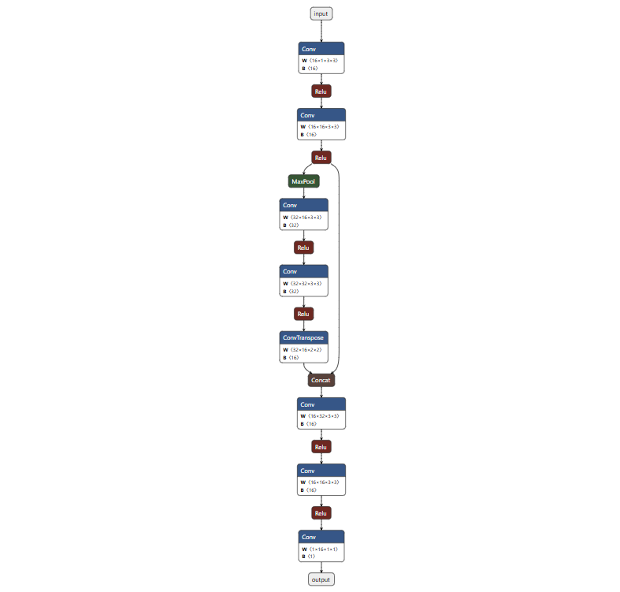

# LinePatrol V1

## 网络架构




## 目录结构

```
AICleanBot/
├── main/                    # ESP32-S3主程序
│   ├── app_main.cpp         # 主入口：摄像头采集和推理
│   ├── CMakeLists.txt       # 构建配置
│   └── idf_component.yml    # 依赖组件
│
├── py_scripts/             # Python工具脚本
│   ├── dataset/            # 数据集
│   │   ├── FRAME_QQVGA/    # 原始图像 (160x120)
│   │   └── FRAME_QQVGA_label/  # 标注图像
│   ├── figure/             # 架构图和文档
│   │   └── architecture.png
│   ├── models/             # 训练好的模型
│   ├── net/                # 神经网络相关
│   │   ├── train_student.py  # 训练学生模型
│   │   ├── train_teacher.py  # 训练教师模型
│   │   ├── inference.py       # 模型推理
│   │   └── quantize_onnx_model.py  # ONNX量化
│   ├── utils/              # 工具脚本
│   │   ├── capture_img_serve.py   # ESP32摄像头服务器
│   │   ├── capture_img_client.py  # PC端图像采集客户端
│   │   ├── label_tool.py          # 标注工具
│   │   ├── label_visual.py        # 标注可视化
│   │   └── tools.py               # 辅助工具
│   └── simulation/         # 仿真测试
│
├── build/                 # 编译输出
├── bin/                   # 二进制文件
├── CMakeLists.txt        # 顶层CMake配置
├── sdkconfig*            # ESP-IDF配置文件
└── README.md             # 本文档
```

## 主要功能

### 1. 摄像头采集 (C++/Python)
- **ESP32-S3端**: 使用ESP-IDF camera driver持续采集灰度图像
- **参数配置**: 160x120分辨率、20MHz时钟、灰度格式
- **网络传输**: 通过TCP协议传输图像数据到PC端

### 2. 深度学习模型
- **教师模型**: UNet 网络用于训练高质量标签
- **学生模型**: UNet 精简网络用于边缘部署
- **模型格式**: FP32 ONNX → INT8 量化模型
- **推理框架**: ESP-DL (Deep Learning Library for ESP32)

### 3. 数据标注工具
- 自动标注: 使用教师模型生成伪标签
- 可视化: 标注结果对比展示
- 数据管理: 支持数据集增删改查

### 4. 模型训练流程
```bash
# 1. 采集数据
python py_scripts/utils/capture_img_client.py

# 2. 标注数据
python py_scripts/utils/label_tool.py

# 3. 训练学生模型
python py_scripts/net/train_student.py

# 4. 导出ONNX模型
# (train_student.py自动导出)

# 5. 量化模型
python py_scripts/net/quantize_onnx_model.py

# 6. 部署到ESP32-S3
idf.py build flash monitor
```

