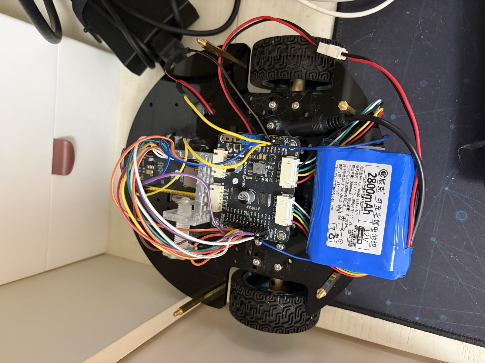
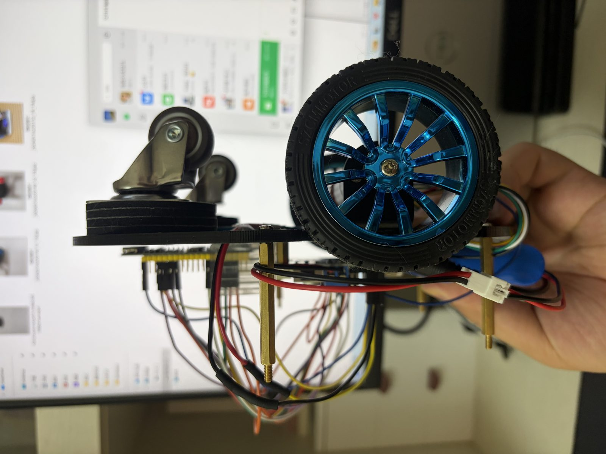
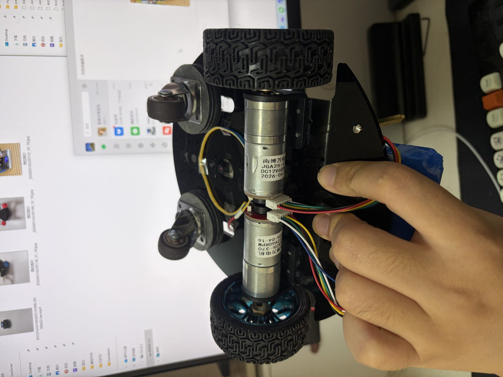
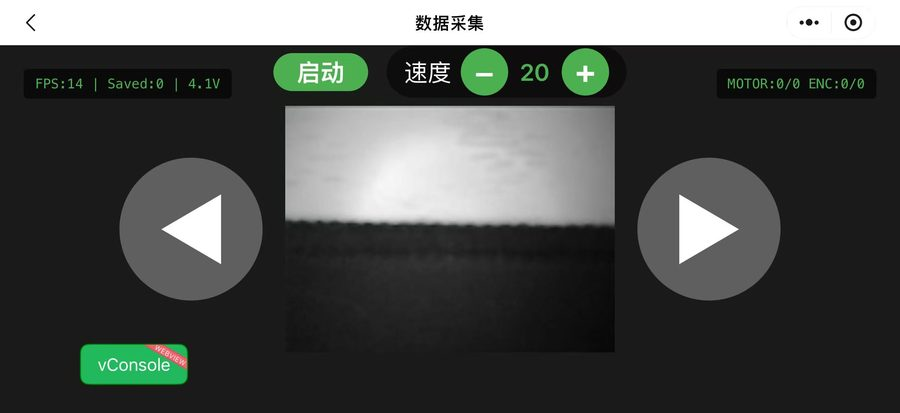
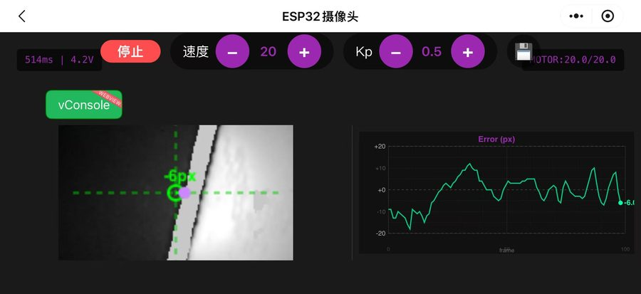
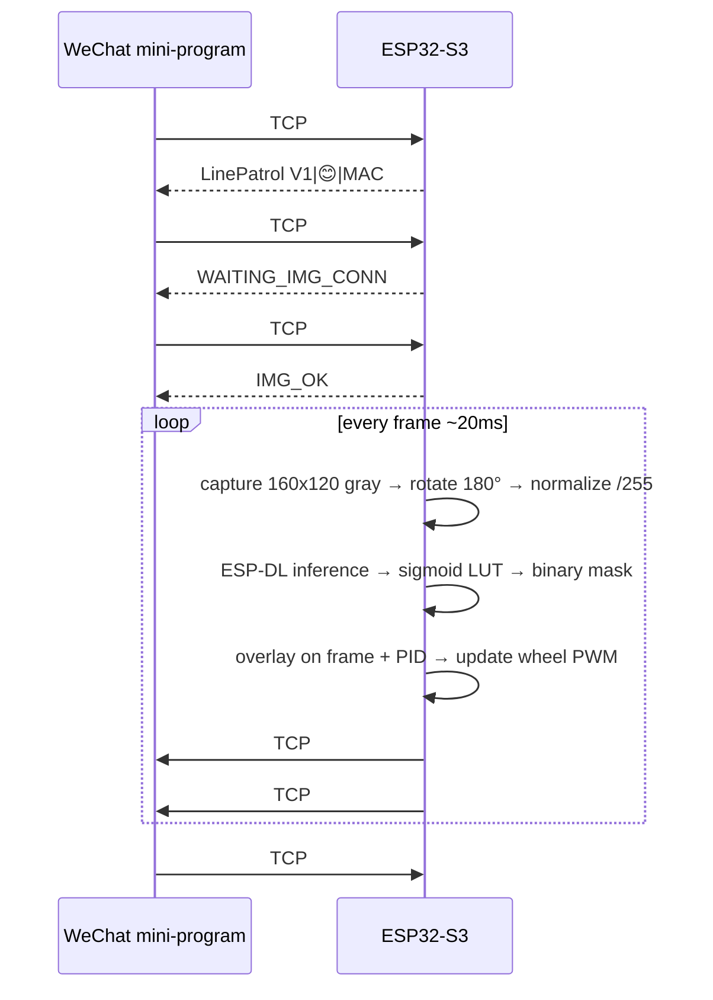
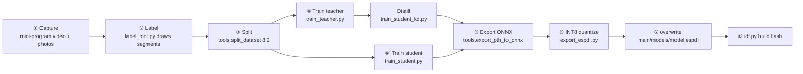

# AICleanBot

**English | [简体中文](README.md)**

**An Open-Source AI Robot on ESP32-S3** · Real-time Semantic Segmentation · Autonomous Line Following · Edge Inference

[](LICENSE)
[](https://docs.espressif.com/projects/esp-idf/)
[](https://www.espressif.com/en/products/socs/esp32-s3)
[](https://aishuaiyao.github.io/AICleanBot/)

**[🌐 Project Site](https://aishuaiyao.github.io/AICleanBot/)** · **[🔧 Hardware](hardware/README.md)** · **[🗺 Roadmap](ROADMAP.md)** · **[🤝 Contributing](CONTRIBUTING.md)**



A real-time semantic segmentation robot built on **ESP32-S3**: a U-Net runs on a ~$6 MCU, finds the guide line in the camera frame, and a PID controller drives the wheels along it.

This repository ships the **whole loop** — plug it in and collect data, click a few buttons and train, change one line and flash the new model back:

```
Camera capture → mini-program remote capture → PC labeling → train / distill
              → INT8 quantize → back to on-device inference → drive the wheels
```

No cloud GPU, no extra host computer required.

| Item | Value |
|------|-------|
| MCU | ESP32-S3, 240 MHz, 8 MB Flash + 8 MB PSRAM |
| Model input | 160×120 single-channel grayscale (QQVGA) |
| On-device model | Lightweight U-Net variant `UNetMiniExp5`, INT8, ~148 KB |
| Task | Per-pixel binary classification (background / guide line) |
| Control | Centroid error → PID → differential drive |

### Measured results

All numbers below come from the real training logs kept in `logs/` — same dataset (262 images, 8:2 split, `seed=42`), same hyperparameters. Use them to check whether your reproduction is on track:

| Model | Best val IoU | Weights | Deployable on device |
|------|-------------|---------|---------------------|
| U-Net + ResNet18 (teacher) | **0.9100** | large | ❌ PC only, used as distillation teacher |
| `UNetMiniExp5` (trained directly) | 0.8169 → 0.8574 | ~334 KB | ✅ |
| `UNetMiniExp5` + knowledge distillation | **0.8791** | ~334 KB | ✅ ← the model shipped in this repo |

Logs: `logs/train/20260416_213640_UNet_ResNet18.txt` (teacher), `logs/train/20260416_225153_UNetMiniExp5_KD.txt` (distilled student).

Distillation pushes the same small model from 0.857 to 0.879 IoU at the cost of one extra teacher run; the teacher itself only reaches 0.910, which means on this 160×120 single-channel task the small model is already close to the ceiling.

**Measure on-device speed yourself** — no hardcoded number here, because it varies a lot with camera module, PSRAM batch and WiFi interference. In experiment mode the serial console prints per-stage timings **every 100 frames**:

```
[Exp] frame0100 | cap<ms> pre<ms> infer<ms> post<ms> overlay<ms> | pid<ms> send<ms> | total<ms> | G1=.. G2=.. | line OK
                                     ↑ this one is the model inference time
```

Run `idf.py -p COM3 monitor` to see it.

---

## Table of contents

- [Showcase](#showcase)
- [Features](#features)
- [Two ways to get started](#two-ways-to-get-started)
- [Hardware](#hardware)
- [Software setup](#software-setup)
- [Path A: run line following with the pretrained model](#path-a-run-line-following-with-the-pretrained-model)
- [Path B: train your own model](#path-b-train-your-own-model)
- [Communication protocol](#communication-protocol)
- [Repository structure](#repository-structure)
- [Firmware code tour](#firmware-code-tour)
- [Python tools cheat sheet](#python-tools-cheat-sheet)
- [Troubleshooting FAQ](#troubleshooting-faq)
- [Roadmap](#roadmap)
- [Acknowledgements](#acknowledgements)
- [Citation](#citation)
- [License](#license)

---

## Showcase

| Autonomous run | The robot |
|---|---|
|  |  |

More photos, orthographic views, 3D-printed parts and wiring pictures are in [hardware/photos](hardware/photos); demo videos are on the [project site](https://aishuaiyao.github.io/AICleanBot/#demo).

---

## Features

**Firmware (`main/`)**

- ESP-DL loads an INT8 model and segments every 160×120 frame
- Sigmoid lookup table for post-processing — no floating point per pixel
- Centroid of the guide line → PID → differential wheel speeds
- 3rd motor (brush / vacuum) with independent PWM
- Sliding-window **collision detection** from encoders (triggers at 85% of mean speed), no extra sensor
- Line-lost protection: auto stop after 5 consecutive frames without a line
- Battery voltage via ADC + breathing LED status indicator
- **Dual channel**: TCP 5000 for commands, UDP 5001 for video, plus a dedicated TCP channel that streams the segmentation overlay in experiment mode
- **OTA updates**: two app partitions, flash once over serial and update over the air afterwards

**Host (`smartcat/` submodule)**

Native WeChat mini-program: device discovery, TCP handshake, live video, single-frame capture, remote control, local/cloud dataset management, encoder logging with histogram export.

**Training tools (`py_scripts/`)**

Teacher (U-Net + ResNet18 encoder) → knowledge distillation → lightweight student → ONNX → INT8 → `.espdl`, all in one script chain.

---

## Two ways to get started

| | Path A | Path B |
|---|---|---|
| **What** | Run line following with the model already in the repo | Retrain on your own data |
| **Needs** | One ESP32-S3 + hardware | Everything in A, plus a PC that can run PyTorch |
| **Time** | ~30 min (including soldering) | Training extra: hours on CPU, ~30 min on GPU |
| **You get** | A robot that follows a line and cleans | A new model adapted to your floor |

If this is your first contact, finish Path A first, then come back for Path B.

---

## Hardware

> Full hardware documentation lives in **[`hardware/`](hardware/README.md)**: machine-readable BOM, schematic PDF, TB6612 driver datasheet, EasyEDA project, ready-to-slice STL files, assembly order and wiring photos.

### Bill of materials

| Part | Model / spec | Qty | Notes |
|------|-------------|-----|-------|
| MCU | ESP32-S3-WROOM-1 (N16R8, 8 MB PSRAM) | 1 | **PSRAM is mandatory**, camera frame buffer lives there |
| Camera | OV2640 | 1 | Directly wired to ESP32-S3, no FIFO |
| Motor driver | TB6612FNG | 1 | Smaller and more efficient than L298N |
| Geared motor | JGA25-370 with AB encoder | 2 | Encoders used for odometry and collision detection |
| Cleaning motor | Small DC motor + driver | 1 | The 3rd motor, optional |
| Battery | 12 V Li-ion pack | 1 | Stepped down to 5 V for the MCU |
| Buck converter | 12 V → 5 V DC-DC | 1 | Output ≥ 2 A |
| Voltage divider | 100 k + 10 k (1:11) | 1 pair | Battery sensing, see below |
| Chassis / wheels / caster | — | 1 set | — |

> **On PSRAM**: `sdkconfig.defaults.esp32s3` enables `CONFIG_SPIRAM=y` and `fb_location = CAMERA_FB_IN_PSRAM`. A module without PSRAM compiles fine but will always crash in `esp_camera_init`.

> **On the camera**: this project does **not** use the FIFO-equipped "ESP32-CAM" breakout board. It wires a bare OV2640 to the ESP32-S3 8-bit bus. If you only have an ESP32-CAM module, every pin has to be remapped.

### Pinout

**Camera (OV2640)**

| Function | GPIO | Function | GPIO |
|----------|------|----------|------|
| XCLK | 15 | D0 | 11 |
| SIOD (SDA) | 4 | D1 | 9 |
| SIOC (SCL) | 5 | D2 | 8 |
| VSYNC | 6 | D3 | 10 |
| HREF | 7 | D4 | 12 |
| PCLK | 13 | D5 | 18 |
| — | — | D6 | 17 |
| — | — | D7 | 16 |

XCLK outputs 20 MHz. PWDN / RESET unused (both -1).

**Motor driver (TB6612FNG)**

| Function | GPIO | Note |
|----------|------|------|
| Left wheel PWM | 39 | PWMB, speed |
| Left wheel IN1 | 2 | **shared** with right IN1 |
| Left wheel IN2 | 42 | **shared** with right IN2 |
| Right wheel PWM | 14 | PWMA, speed |
| 3rd motor PWM | 45 | LEDC channel 4, initial duty 20% |

> Sharing IN1/IN2 means the wheels can run at different speeds but **not** in different directions; turning relies on the PWM difference. This is a deliberate trade-off: it frees 4 GPIOs for the camera. If your board has GPIOs to spare, split IN1/IN2 per side and edit the `#define`s at the top of `main/app_main.cpp`.

**Encoders (JGA25-370)**

| Function | GPIO |
|----------|------|
| Left A | 47 |
| Left B | 21 |
| Right A | 41 |
| Right B | 40 |

The firmware uses **PCNT single-channel 1× counting** (rising edge of phase A). The counter wraps every 32768 pulses; the host filters the jump.

**Misc**

| Function | GPIO | Note |
|----------|------|------|
| Battery voltage | 1 | ADC1_CH0, divider 1/11 |
| Breathing LED | 38 | LEDC channel 3, 10-bit |

LED/PWM parameters: motors 1 kHz / 8-bit, breathing LED 10-bit.

### Pre-power checklist

- [ ] Camera **data line order D0–D7** is correct — the easiest thing to get wrong and the only one with no error message
- [ ] TB6612 **PWMA/PWMB** go to 14 / 39; swapping them makes "turn left" go right
- [ ] The driver's **STBY** pin is pulled high (often forgotten; motors stay dead while logs look fine)
- [ ] Both encoder **A and B** phases are wired; A alone spins but the speed loop breaks
- [ ] Battery divider uses **100 k + 10 k** — the ADC pin cannot take 12 V directly

---

## Software setup

### 1. Clone

`smartcat` is a git submodule, so `--recurse-submodules` is **required**, otherwise the mini-program directory is empty:

```bash
git clone --recurse-submodules https://github.com/AishuaiYao/AICleanBot.git
cd AICleanBot
```

Already cloned?

```bash
git submodule update --init --recursive
```

### 2. ESP-IDF (required for firmware)

Built on **ESP-IDF v5.4.x**, tested on v5.4.0. ESP-DL requires IDF ≥ 5.3.

- Windows: <https://docs.espressif.com/projects/esp-idf/en/v5.4/esp32s3/get-started/windows-setup.html>
  The offline installer is recommended; it sets up Python, CMake, Ninja and the toolchain.
- Linux / macOS: <https://docs.espressif.com/projects/esp-idf/en/v5.4/esp32s3/get-started/linux-macos-setup.html>

```bash
idf.py --version      # expect ESP-IDF v5.4.x
```

On Windows you must activate the environment in every new terminal — or just open **ESP-IDF 5.4 PowerShell** from the Start menu.

### 3. Python (Path B only)

Python **3.10 – 3.12** (3.13 may fail to install `segmentation_models_pytorch`).

```bash
python -m venv .venv
source .venv/bin/activate          # Windows: .venv\Scripts\Activate.ps1
pip install -r requirements.txt
```

If the CPU-only torch download is slow:

```bash
pip install torch==2.5.0 torchvision==0.20.0 --index-url https://download.pytorch.org/whl/cpu
```

### 4. WeChat DevTools (optional)

Download the stable build from [WeChat](https://developers.weixin.qq.com/miniprogram/dev/devtools/download.html). Cloud development is optional — plain LAN TCP/UDP works out of the box.

---

## Path A: run line following with the pretrained model

### Step 1: make sure the model file is there

`main/models/model.espdl` **is committed** (~148 KB). It is embedded into the firmware at build time:

```cmake
# main/CMakeLists.txt
set(embed_files models/model.espdl)
target_add_aligned_binary_data(${COMPONENT_LIB} ${embed_files} BINARY)
```

> Do not delete it. If the file is missing after cloning, you are using an old `.gitignore` or a source-only tarball.

### Step 2: build, flash, watch the log

```bash
idf.py set-target esp32s3      # once
idf.py build
idf.py -p COM3 flash monitor   # Windows COM3; Linux /dev/ttyUSB0
```

The first build downloads `esp32-camera` and `esp-dl`; allow a few minutes. Success looks like:

```
[Camera] 初始化成功 (QQVGA 160x120 灰度)
[TCP] Server已启动, 端口=5000
```

`Ctrl + ]` exits the monitor.

### Step 3: join the device hotspot

The firmware defaults to **AP mode**:

| Item | Value |
|------|-------|
| SSID | `LinePatrol V1` |
| Password | `********` (placeholder — set your own) |
| Device IP | `192.168.4.1` |
| TCP command port | `5000` |
| UDP video port | `5001` |

> **Do this before flashing**: every password in the repo has been replaced with the placeholder `********`.
> Edit `#define AP_PASSWORD` at the top of `main/app_main.cpp` and set your own (WPA2 requires ≥ 8 chars), then rebuild.
> Same for `#define AP_SSID` (`LinePatrol V1` works as-is).
>
> 8 asterisks instead of 2: `esp_wifi_start()` returns `ESP_ERR_WIFI_PASSWORD` for anything shorter than 8, and an AP that never comes up looks like a firmware bug.

### Step 4: verify it is alive with one command

```bash
printf 'HELLO\n' | nc 192.168.4.1 5000
# → LinePatrol V1|😊|AA:BB:CC:DD:EE:FF
```

On Windows PowerShell:

```powershell
$t = New-Object Net.Sockets.TcpClient("192.168.4.1", 5000)
$s = $t.GetStream()
$b = [Text.Encoding]::ASCII.GetBytes("HELLO`n"); $s.Write($b, 0, $b.Length)
$buf = New-Object byte[] 64; $n = $s.Read($buf, 0, 64)
[Text.Encoding]::ASCII.GetString($buf, 0, $n)
```

### Step 5: make it follow the line

Manual mode:

| Command | Effect |
|---------|--------|
| `START:60` | Start at 60% base speed (also starts motor 3) |
| `MOTOR_FORWARD` | Straight |
| `MOTOR_LEFT` | Turn left |
| `MOTOR_RIGHT` | Turn right |
| `SPEED:80` | Set speed, 1~100 |
| `MOTOR3:128` | 3rd motor duty cycle, 0~255 |
| `STOP` | Stop |

Real **autonomous** line following is experiment mode — via the mini-program, or by sending `EXPERIMENT` directly.

> **Note**: every command must end with `\n`, and **each connection must send `HELLO` first**, otherwise the firmware drops it.

### Step 6: connect the WeChat mini-program

| Data capture | Device control |
|---|---|
|  |  |

Import `smartcat/` in WeChat DevTools with **your own AppID** (the one in the repo is a placeholder):

1. Connect your phone to the `LinePatrol V1` hotspot
2. On the home page tap `+` to discover devices, pick `192.168.4.1`
3. **Device page** → TCP handshake → single-frame capture to check the image
4. **Capture page** → live video stream → remote control
5. **Experiment mode** → segmentation overlay + autonomous line following

See [`smartcat/README.md`](smartcat/README.md) for details.

### What happens in experiment mode



**Frame format** (TCP#2, fixed 19210 bytes):

| Offset | Length | Content |
|--------|--------|---------|
| 0 | 2 | Frame number (big endian) |
| 2 | 1 | Battery voltage (ADC value) |
| 3 | 1 | Left wheel PWM |
| 4 | 1 | Right wheel PWM |
| 5 | 1 | Centroid G1 (near guide line x) |
| 6 | 1 | Centroid G2 (far guide line x) |
| 7 | 1 | Left wheel jump rate |
| 8 | 1 | Right wheel jump rate |
| 9 | 1 | Motor running flag |
| 10 | 19200 | 160×120 overlay image (1 byte per pixel) |

Live tuning inside experiment mode: `KP:0.8` (proportional gain 0~5), `SPEED:70`, `MOTOR3:200`, `STOP_EXPERIMENT`.

---

## Path B: train your own model

### Pipeline



> **A ready-to-train dataset ships with the repo.** `py_scripts/dataset/train` (209 images) and `py_scripts/dataset/val` (53) are version-controlled, so **①②③ can be skipped** — start at ④ to reproduce training.
>
> Only do ①~③ if you want to capture your own scene.

Every script derives its paths from its own location (`Path(__file__).resolve().parents[2]`), so **the repo runs from any directory** without editing paths.

### ① Capture

Either way works:

**Option 1: mini-program (recommended)**

Put the robot on the target floor, drive it around with `MOTOR_*`, and save frames from the capture page. Then copy the images to `py_scripts/dataset/FRAME_QQVGA/`.

**Option 2: direct from PC (MicroPython firmware)**

`py_scripts/utils/capture_img_serve.py` is a **MicroPython** script that runs *on the ESP32* — not a PC script.

```bash
# 1. flash MicroPython to the ESP32-S3
#    included: bin/freeRTOS/ESP32_GENERIC_S3-SPIRAM_OCT-20250809-v1.26.0.bin
esptool.py --chip esp32s3 --port COM3 write_flash -z 0x0 \
  bin/freeRTOS/ESP32_GENERIC_S3-SPIRAM_OCT-20250809-v1.26.0.bin

# 2. upload and run py_scripts/utils/capture_img_serve.py with Thonny / ampy

# 3. receive and save frames on the PC
python py_scripts/utils/capture_img_client.py
```

Images land in `py_scripts/dataset/FRAME_QQVGA/` as 160×120 grayscale PNG.

> This script uses its own AP (`CAM-AP`), different from the main firmware. Re-flash with `idf.py flash` afterwards.

### ② Label

`label_tool.py` is an interactive OpenCV tool — **click two points to draw a segment** for the guide line, and it thickens it into a mask:

```bash
python py_scripts/utils/label_tool.py
```

| Key | Action |
|-----|--------|
| Two left clicks | Draw one segment |
| `Enter` | Save and go to the next image |
| `Space` | Skip (empty labels are rejected) |
| `Esc` | Quit |

Parameters at the top of the file: `line_expand = 4` (line width), `scale_size = 700` (window width, does not affect output).

Already labeled images are skipped, so interrupting and rerunning is safe.

**Where the output goes**

| Product | Directory |
|---------|-----------|
| Label mask | `py_scripts/dataset/FRAME_QQVGA_label/` |
| Grayscale (input already grayscale) | `py_scripts/dataset/FRAME_QQVGA/` — written back; identical content, just re-encoded |
| Grayscale (input is **color**) | `py_scripts/dataset/FRAME_QQVGA_gray/` — **the color original is never modified** |

The capture client stores 160×120 grayscale PNGs, so you normally hit row two. Row three only appears if you feed color images in — in that case point `split_dataset`'s image directory at `FRAME_QQVGA_gray`.

The script is also importable (no window pops up on import):

```python
from label_tool import draw_thick_line_on_single_channel
```

### ③ Split train / val

```python
python -c "
import sys
sys.path.insert(0, r'py_scripts/utils')
from tools import split_dataset
from pathlib import Path

root = Path('py_scripts/dataset')
split_dataset(
    str(root / 'FRAME_QQVGA'),
    str(root / 'FRAME_QQVGA_label'),
    str(root / 'train'),
    str(root / 'val'),
    train_ratio=0.8,
    seed=42,
)
"
```

Output: 262 images → train 209 / val 53, laid out as `train/images`, `train/labels`, `val/images`, `val/labels`.

To eyeball the labeling quality:

```python
python -c "
import sys
sys.path.insert(0, r'py_scripts/utils')
from tools import visualize_labels
visualize_labels('py_scripts/dataset/train/images', 'py_scripts/dataset/train/labels')
"
```

### ④ Train

Pick one of three scripts; hyperparameters live in the config block at the top of each file.

| Script | Model | Notes |
|--------|-------|-------|
| `train_teacher.py` | U-Net + ResNet18 encoder (`segmentation_models_pytorch`) | Accurate but large, **PC only**, used as distillation teacher |
| `train_student.py` | `UNetMiniExp5` (custom, ~334 KB) | Small deployable model, **no distillation** |
| `train_student_kd.py` | Same + knowledge distillation | **Recommended** |

```bash
python py_scripts/net/train_teacher.py        # optional, needed for distillation
python py_scripts/net/train_student.py        # train the student directly
python py_scripts/net/train_student_kd.py     # or distill (needs teacher weights first)
```

> **Distillation needs teacher weights first.** Run `train_teacher.py`, put the generated directory name into `TEACHER_MODEL_PATH` in `train_student_kd.py`, or override it with an environment variable:
>
> ```bash
> export TEACHER_MODEL_PATH="py_scripts/models/<your dir>/best_model.pth"
> python py_scripts/net/train_student_kd.py
> ```

**Key hyperparameters (defaults)**

| Parameter | Teacher | Student | Distillation |
|-----------|---------|---------|--------------|
| Batch size | 8 | 8 | 8 |
| Learning rate | 1e-3 (encoder ×0.1) | 1e-3 | 1e-3 |
| Early stop patience | 20 | 10 | 20 |
| Max epochs | 1000 | 1000 | 1000 |
| Loss | 0.5×Focal + 0.5×Dice | same | 0.6×hard + 0.4×KD |
| Temperature T | — | — | 4.0 |
| α | — | — | 0.6 |
| Scheduler | CosineAnnealing (T_max=200) | CosineAnnealingWarmRestarts (T_0=10, T_mult=2) | same as student |
| Seed | 42 | 42 | 42 |

Training prints Loss / IoU / pixel accuracy per epoch and ends with `Training completed! Best val IoU: x.xxxx` — that is where the numbers in [Measured results](#measured-results) come from. The best epochs write validation visualizations to `py_scripts/dataset/pred/`, and curves to `py_scripts/figure/<run dir>/training_curves.png`.

Artifacts: `py_scripts/models/<timestamp>_<model name>/best_model.pth`.

> **On VRAM**: 160×120 input is tiny, batch 8 fits in 4 GB. Without a GPU it falls back to CPU: 262 images × 100 epochs takes a few hours.

### ⑤ Export ONNX

```python
python -c "
import sys
sys.path.insert(0, r'py_scripts/net')
sys.path.insert(0, r'py_scripts/utils')
from train_student import UNetMiniExp5
from tools import export_pth_to_onnx

run = r'py_scripts/models/<your run dir>'
export_pth_to_onnx(
    UNetMiniExp5,
    run + r'/best_model.pth',
    run,
    input_shape=(1, 1, 120, 160),   # NCHW, note H=120 W=160
)
"
```

Output is opset 11, input/output named `input` / `output`, with dynamic batch/height/width.

Check parameter count and FLOPs while you are at it:

```python
python -c "
import sys; sys.path.insert(0, r'py_scripts/utils')
from tools import analyze_onnx_model
analyze_onnx_model(r'py_scripts/models/<your run dir>/model.onnx')
"
```

### ⑥ Quantize to ESP-DL

```bash
pip install esp-ppq          # not in the default requirements
python py_scripts/utils/export_espdl.py
```

Set `MODEL_RUN_DIR` in the script to your run directory, and make sure the calibration set `py_scripts/dataset/FRAME_QQVGA/` has images (128 are used by default).

| Parameter | Value |
|-----------|-------|
| Target | `esp32s3` (`esp32p4` / `c` also possible) |
| Bits | INT8 |
| Calibration samples | 128 |
| Input shape | `[1, 1, 120, 160]` |
| Preprocessing | grayscale → `/255.0` → `[1, H, W]` |

Output: `model.espdl`, plus a quantization error report and checksums.

### ⑦ Deploy back to the board

```bash
cp py_scripts/models/<your run dir>/model.espdl main/models/model.espdl
# Windows: Copy-Item py_scripts\models\<run>\model.espdl main\models\model.espdl -Force

idf.py build
idf.py -p COM3 flash monitor
```

### ⑧ Verify the new model

**Option 1: PC-side inference (no hardware needed)**

```bash
python py_scripts/net/inference.py \
  --model py_scripts/models/<your run dir>/best_model.pth \
  --input py_scripts/dataset/val/images
```

Results go to `py_scripts/dataset/pred_<run dir>/` as purple overlays.

> The **parent directory name of `--model` must contain the model type** (e.g. `UNetMiniExp5`, `UNet_ResNet18`); the script infers the architecture from it.

**Option 2: run it on the board**

Change `set(srcs app_main.cpp)` to `set(srcs inference_test.cpp)` in `main/CMakeLists.txt`, then:

```bash
idf.py build flash monitor
python py_scripts/utils/inference_test.py
```

The script sends every image in `py_scripts/utils/test_images/` to the ESP32, collects the binary masks, and writes side-by-side comparisons to `py_scripts/utils/test_results/`. Remember to switch `main/CMakeLists.txt` back to `app_main.cpp`.

### OTA update (optional)

Dual app partitions (`partitions.csv`: `ota_0` / `ota_1`, 3900 K each). After the first serial flash, push updates like this:

```
OTA:START:<firmware name>:<byte count>
```

The device replies `OTA_READY`, then receives the binary stream, reports `OTA_PROGRESS:<percent>`, and finishes with `OTA_OK` plus an automatic reboot. Failures return `OTA_FAIL:<reason>`.

---

## Communication protocol

### Connection rules

- **The first message on every TCP connection must be `HELLO\n`**, otherwise `handle_client` closes it immediately
- Commands end with `\n`; the firmware reads until `\n`, max 128 bytes per command
- Only 1 client at a time (`AP_MAX_CONN = 1`)

### Handshake response

```
LinePatrol V1|😊|AA:BB:CC:DD:EE:FF
```

Format: `<device name>|<icon>|<MAC>`.

### TCP command table (port 5000)

| Command | Argument | Description |
|---------|----------|-------------|
| `HELLO` | — | Handshake, must be first |
| `START:<n>` | n = 1~100 | Start at n% speed, also starts motor 3 |
| `SPEED:<n>` | n = 1~100 | Change speed (ignored before `START`) |
| `MOTOR_FORWARD` | — | Straight |
| `MOTOR_LEFT` | — | Turn left (left wheel half speed) |
| `MOTOR_RIGHT` | — | Turn right (right wheel half speed) |
| `STOP` | — | Stop all motors |
| `CAPTURE` | — | Grab a single frame |
| `UDP_HELLO:<port>` | phone's local UDP port | Register the video destination |
| `STREAM` | — | Start UDP video |
| `STOP_STREAM` | — | Stop video |
| `EXPERIMENT` | — | Enter experiment mode (autonomous + overlay) |
| `STOP_EXPERIMENT` | — | Leave experiment mode |
| `KP:<f>` | f = 0.0~5.0 | Tune PID proportional gain (in experiment mode) |
| `MOTOR3:<n>` | n = 0~255 | 3rd motor duty cycle |
| `OTA:START:<file>:<size>` | — | Trigger OTA, see above |

### UDP video stream (port 5001)

The mini-program listens on local port 5002 and announces it with `UDP_HELLO:5002`.

Each frame is 19200 bytes, split into 3 chunks (8000 / 8000 / 3200):

```
[frame num high][frame num low][total chunks][chunk index][image data...]
```

**Only the first chunk** carries 8 extra telemetry bytes:

```
[voltage][left PWM][right PWM][enc L high][enc L low][enc R high][enc R low]
```

### Experiment mode frame

See [step 6](#what-happens-in-experiment-mode): fixed 19210 bytes = 10-byte header + 19200-byte overlay.

### Encoder / collision log

Serial format (visible with `idf.py monitor`):

```
[Enc] OK | cur L=1234 R=1250 | delta 12 13 | ratio 97% (thr=85%) | running=1
[Enc] TRIGGER | cur L=1234 R=1250 | delta 3 2 | ratio 22% (thr=85%) | running=1
```

Save it to a file and plot:

```python
python -c "
import sys; sys.path.insert(0, r'py_scripts/utils')
from tools import parse_and_plot_enc_log
parse_and_plot_enc_log('logs/encoder/4.txt')
"
```

---

## Repository structure

```
AICleanBot/
├── main/                              # ESP32-S3 firmware (ESP-IDF component)
│   ├── app_main.cpp                   # capture / inference / WiFi / motors / encoders / PID / OTA
│   ├── inference_test.cpp             # on-device inference test (with utils/inference_test.py)
│   ├── motor_encoder_test.cpp         # standalone motor + encoder test
│   ├── models/model.espdl             # 【must be committed】INT8 model embedded at build time
│   ├── CMakeLists.txt                 # switch `srcs` to switch firmware flavor
│   └── idf_component.yml              # esp32-camera / esp-dl dependencies
│
├── py_scripts/                        # Python toolchain
│   ├── net/
│   │   ├── train_teacher.py           # teacher training (U-Net + ResNet18)
│   │   ├── train_student.py           # student model definitions + training (7 variants)
│   │   ├── train_student_kd.py        # knowledge distillation
│   │   └── inference.py               # PC inference visualization (only script with argparse)
│   ├── utils/
│   │   ├── tools.py                   # ONNX export / dataset split / log plotting / image listing
│   │   ├── label_tool.py              # interactive segment labeling
│   │   ├── export_espdl.py            # INT8 quantization → .espdl
│   │   ├── capture_img_serve.py       # 【MicroPython, runs on ESP32】image server
│   │   ├── capture_img_client.py      # PC capture client
│   │   ├── inference_test.py          # on-device verification client
│   │   ├── test_images/               # sample images for on-device verification
│   │   └── test_results/              # verification output (ignored)
│   ├── simulation/                    # algorithm prototypes (DFS traversal, endpoint detection)
│   ├── dataset/
│   │   ├── train/{images,labels}/     # 209 images, committed, ready to train
│   │   ├── val/{images,labels}/       # 53 images, committed
│   │   └── FRAME_QQVGA*/              # raw captures, large, not committed
│   ├── models/                        # training artifacts, large, not committed
│   └── figure/                        # training curves and charts
│
├── hardware/                          # hardware design files
│   ├── README.md                      # BOM, assembly, wiring checks
│   ├── bom.csv                        # machine-readable BOM
│   ├── datasheets/                    # ESP32-S3-CAM schematic, TB6612 datasheet
│   ├── cad/                           # enclosure / chassis / tank STL (mm)
│   ├── pcb/                           # EasyEDA project
│   └── photos/                        # photos, orthographic views, prints, wiring
│
├── docs/                              # project site (GitHub Pages source)
│   ├── index.html
│   └── assets/                        # styles, images, demo videos
│
├── .github/
│   ├── ISSUE_TEMPLATE/                # bug / feature templates
│   ├── PULL_REQUEST_TEMPLATE.md
│   └── workflows/pages.yml            # Pages auto deploy
│
├── smartcat/                          # WeChat mini-program host (git submodule)
├── bin/freeRTOS/                      # MicroPython firmware (for capture_img_serve.py)
├── logs/                              # training / quantization / encoder log samples
├── partitions.csv                     # dual OTA partition table
├── sdkconfig.defaults.esp32s3         # target chip, PSRAM and cache defaults
├── requirements.txt                   # Python dependencies
├── ROADMAP.md                         # public roadmap
├── CONTRIBUTING.md
├── NOTICE
├── LICENSE                            # Apache-2.0
└── README.md                           # this file (see README_EN.md for English)
```

### Firmware code tour

Four places are enough to start hacking the firmware:

| Location | Responsibility |
|----------|----------------|
| `app_main()` (L1614) | Power-on init: camera → WiFi AP → LEDC/PWM → PCNT encoders → load `.espdl` → create tasks |
| `tcp_server_task()` (L1580) | TCP 5000 server, accept loop |
| `handle_client()` (L1092) | Command parsing and dispatch; **the experiment-mode inference loop also lives here** (from L711: capture → preprocess → infer → postprocess → overlay → PID → send) |
| `breath_led_task()` (L473) | Status LED |

Typical edits: add a command → add a `strncmp` branch in `handle_client`; tune driving feel → edit the PID section in the experiment loop (search `g_pid_kp`); swap the model → replace `main/models/model.espdl`, no code change needed.

---

## Python tools cheat sheet

| Script | Runs on | Purpose | CLI args |
|--------|---------|---------|----------|
| `net/train_teacher.py` | PC | Train teacher | none, edit constants at top |
| `net/train_student.py` | PC | Student model definition + training | none, edit constants at top |
| `net/train_student_kd.py` | PC | Knowledge distillation | `TEACHER_MODEL_PATH` env var |
| `net/inference.py` | PC | Inference visualization | `--model` `--input` |
| `utils/tools.py` | PC | ONNX export / dataset split / log plotting / image listing | library, call from Python |
| `utils/label_tool.py` | PC | Interactive labeling | none (also importable) |
| `utils/export_espdl.py` | PC | INT8 quantization → `.espdl` | none, edit constants in `__main__` |
| `utils/capture_img_serve.py` | **ESP32 (MicroPython)** | Image server | none |
| `utils/capture_img_client.py` | PC | Capture and save frames | none |
| `utils/inference_test.py` | PC | Verify on-device inference | none |
| `simulation/*.py` | PC | Algorithm prototypes, off the main path | none |

> Except for `net/inference.py`, none of the scripts use argparse — configuration lives in the config block or `__main__` at the top of each file. This is deliberate: embedded projects have few, fixed parameters, and reading the file beats memorizing dozens of flags.

---

## Troubleshooting FAQ

**`esp_camera_init` fails / `Camera probe failed`**

- 99% of the time D0–D7 are wired in the wrong order, or the module has no PSRAM
- Check `CONFIG_SPIRAM=y` in `sdkconfig` (already set by `sdkconfig.defaults.esp32s3`; `idf.py set-target esp32s3` merges it)

**Build error: `No such file or directory: models/model.espdl`**

`main/models/model.espdl` is missing. It is committed — re-run `git pull` and verify submodules.

**Build cannot find esp-dl / esp32-camera**

The first build fetches components over the network; corporate networks may need a proxy for pip / cmake. Also remove any leftover `override_path` entry in `idf_component.yml`.

**Hotspot connected but TCP refuses**

- Make sure you joined `LinePatrol V1` and the gateway is `192.168.4.1`
- Some Android phones reject unencrypted connections
- **Every connection must send `HELLO\n` first**; sending `START:60` directly gets you disconnected

**Only one client at a time**

`AP_MAX_CONN = 1` by default. Change it and rebuild if you need a PC and a phone simultaneously.

**Motors do not spin although the log shows `START` OK**

Check that TB6612FNG's **STBY** is pulled high and that VM (the motor's separate supply) is connected — 5 V on the logic side does not mean the motor side is powered.

**Left / right is reversed**

Swap that motor's two wires, or flip the IN1/IN2 levels in `motor_l_forward` / `motor_r_forward`.

**Line following wobbles / snakes**

Lower the proportional gain: `KP:0.3`. Default is `0.5`, range 0~5. You can also change the initial value of `g_pid_kp` in `app_main.cpp`.

**Does not stop when the line is lost / keeps going full speed**

- Check whether the camera is mounted upside down — the firmware calls `rotate_180_inplace`; comment it out if your camera is already oriented correctly
- Check whether the mask covers the whole frame: run `net/inference.py` on a few images

**`import esp_ppq` raises ModuleNotFoundError**

```bash
pip install esp-ppq
```

It is not in the default requirements because only the quantization step needs it.

**Training: `ImportError: cannot import name 'UNetMiniExp5'`**

`train_student_kd.py` and `net/inference.py` both import `train_student`. Run from `py_scripts/net`, or make sure that directory is on `sys.path`.

**Will `label_tool.py` overwrite my originals?**

Only color inputs were at risk, and current versions handle it: the grayscale version of a color image goes to `FRAME_QQVGA_gray/` and the original is untouched. If the input is already grayscale (the default output of the capture client), the grayscale version is written back — identical to what was read, just re-encoded.

**Windows: `Microsoft Visual C++ 14.x is required`**

Training needs MSVC build tools for torch's C++ extensions. Install Visual Studio Build Tools with the "C++ build tools" workload.

---

## Roadmap

This project is **not finished**. V1 works; later stages were paused (hardware budget, among other reasons). The plan is in [ROADMAP.md](ROADMAP.md):

| Stage | Status | Content |
|-------|:------:|---------|
| V1 visual line following | ✅ | edge segmentation, PID following, collision detection, dual channel, OTA |
| V1.1 cleaning mechanism | ✅ | 3rd motor, brush / suction roller, water tank and structural parts |
| V2 mapping and navigation | 🚧 | DFS coverage traversal port, grid map, odometry fusion |
| V3 autonomous cleaning | 📋 | coverage path planning, boundary detection, docking |
| V4 stronger AI | 💭 | multi-class segmentation, multi-task on-device model |

**Known limitations**

- The model only separates background / guide line; the `UNetMiniExp*` family has a fixed 1-channel output
- Identifiers and comments mix English and Chinese; gradually converging to English identifiers + Chinese comments
- IN1/IN2 are shared between wheels, so spinning in place is impossible (differential turning works)
- Camera orientation relies on a hardcoded `rotate_180_inplace`; check it when changing the camera
- No unit tests anywhere; verification is the manual procedure in the README

Pick up any piece — see [CONTRIBUTING.md](CONTRIBUTING.md).

---

## Acknowledgements

- [ESP-DL](https://github.com/espressif/esp-dl) — makes neural networks on an MCU practical
- [esp32-camera](https://github.com/espressif/esp32-camera)
- [segmentation_models.pytorch](https://github.com/qubvel/segmentation_models.pytorch)
- [esp-ppq](https://github.com/espressif/esp-ppq) — INT8 quantization toolchain
- [PyTorch](https://github.com/pytorch/pytorch) / [MicroPython](https://github.com/micropython/micropython)

---

## Citation

If this repository is useful for your coursework, paper or project, please cite it:

```bibtex
@misc{aicleanbot2026,
  author       = {Aishuai Yao},
  title        = {AICleanBot: An Open-Source ESP32-S3 Robot with On-Device Semantic Segmentation},
  year         = {2026},
  publisher    = {GitHub},
  journal      = {GitHub repository},
  howpublished = {\url{https://github.com/AishuaiYao/AICleanBot}}
}
```

[`CITATION.cff`](CITATION.cff) in the repo root carries the same metadata; GitHub picks it up automatically and shows "Cite this repository".

---

## License

Released under the [Apache License 2.0](LICENSE); third-party component licenses are listed in [NOTICE](NOTICE).

The mini-program host `smartcat/` is a separate repository: <https://github.com/AishuaiYao/smartcat>
